# ccu-addon-battery

[:de: Deutsche README](README.md)

Battery change detection and statistics for Homematic devices: an addon for
[openccu-lite](https://github.com/hobbyquaker/openccu-lite), the classic CCU3 and OpenCCU. It
records the battery voltage and the low-battery flag of every device, detects battery changes from
them, lets you say which batteries went in, and turns the record into how long batteries last, which
devices eat batteries, which batteries do best, what is due soon and what to buy.

**Status: 1.0.0** ([changelog](CHANGELOG.md); the packages are on the [releases
page](https://github.com/hobbyquaker/ccu-addon-battery/releases)). Tested on openccu-lite with real
devices and on OpenCCU; on the CCU3 firmware so far without paired battery devices - feedback is
welcome.

## The pages

The app opens at `/addons/battery/` (on openccu-lite inside the system's shell, with its theme
and language):

- **Devices:** every battery device with its picture, status, batteries, voltage, how long its
  batteries lasted so far (mean, shortest, longest, the number of lives - sortable, shortest
  first, to find the battery-hungry devices) and how long the current ones have been in. A device
  opens its detail: the voltage curve over the whole record with the changes marked and the
  low-battery phases as bands, and its changes, each editable. *Changed…* records a change.
- **Inbox:** what the detector found, waiting for your answer - yes (with the batteries that went
  in), another day, or no. Below it, every recorded change.
- **Batteries:** every battery ever recorded (vendor, product line, size): how many went in, in
  which devices and models, how long they lasted, what they cost per battery and per year - and,
  since a battery's life depends on the device, the life per device model behind each row, plus a
  comparison within one model or size.
- **Shopping:** which devices are low now or due within a horizon you choose, what they need per
  battery type against the stock you keep at home, and what to buy - copyable as a list. The
  forecast behind it is in the Devices table's *Due* column: the expected life is the median of
  the device's own lives, with fewer than two the median of its model here, else the battery
  table's figure; due is the last change plus that minus a fortnight, pulled forward when the
  voltage trend of the last weeks reaches the low level earlier.
- **Statistics:** the last twelve months in numbers, the devices with the shortest lives, the life
  per model and per size, and the exports.

The **settings page** is separate (on openccu-lite under *Addons → Battery → Settings*, on a CCU the
addon's *Einstellungen* button): where the database lives, the notifications and, on a CCU, the
service, its log and the version. Service control and the log are the system's own pages on
openccu-lite.

**Notifications:** over [ntfy](https://ntfy.sh) or a webhook of yours, the addon tells you when a
device reports a low battery, a change is due or due soon, or a detected change waits in the
inbox - each once, and again only after a week. The system itself offers an addon no channel
yet; once it does, it becomes a third one here.

## A walk through the pages

Pictures of every page of the addon, inside openccu-lite's shell (version `0.0.0-prod.4` on
openccu-lite `1.0.0-rc.3`; the UI is German here, the app also speaks English). They show a real
system: 67 battery devices, 149 battery changes taken over from a list of its own and an older
measurement archive; the recording itself has been running there for one day only. Names, rooms,
serial numbers and SGTINs are changed. Every picture comes in the light and the dark theme; your
browser shows the one that matches its setting.

### Devices (Geräte)

<picture><source media="(prefers-color-scheme: dark)" srcset="docs/screenshots/01-geraete-dunkel.png">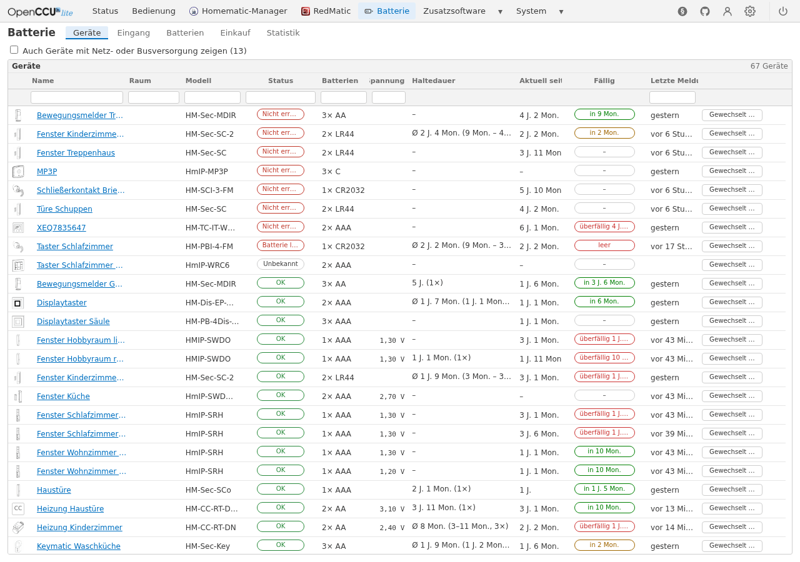</picture>

Every battery device with its picture, status (unreachable, low battery, OK), the batteries from
the battery table, the last voltage, how long its batteries lasted so far, how long the current
ones have been in, when the next change is due and when it last reported. Every column sorts and
filters; the box at the top adds the mains- and bus-powered devices. *Gewechselt …* (Changed…)
records a change straight from the list.

### A device

<picture><source media="(prefers-color-scheme: dark)" srcset="docs/screenshots/02-geraet-dunkel.png">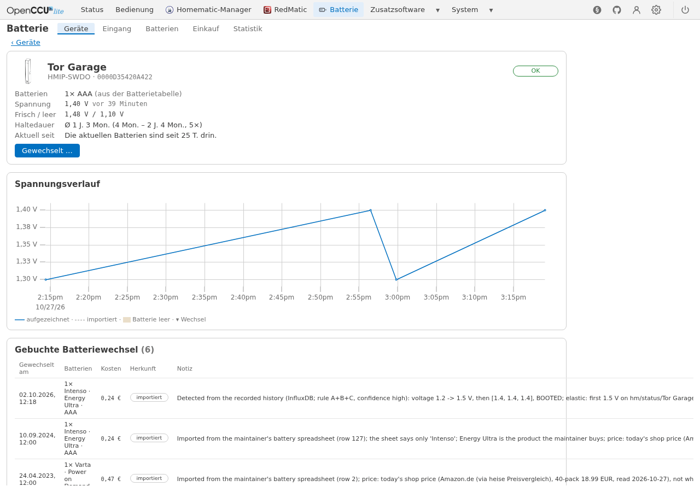</picture>

A click on the name opens the device: batteries, voltage, the fresh and empty thresholds, the
battery lives and the voltage curve over the whole record, with the changes as marks and the
low-battery phases as bands. Below it every recorded change of the device, each editable and
deletable; here the imported ones, their origin in the note.

### Recording a change

<picture><source media="(prefers-color-scheme: dark)" srcset="docs/screenshots/03-wechsel-dunkel.png">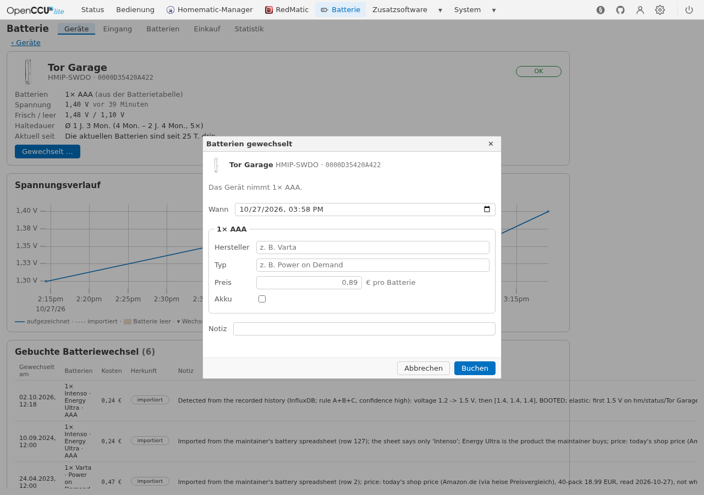</picture>

*Gewechselt …* asks when, and per battery slot what went in: vendor and product line (suggested
from the ones entered before), the price per battery (suggested: the last one paid) and whether
they are rechargeable. The size comes from the battery table.

### Inbox (Eingang)

<picture><source media="(prefers-color-scheme: dark)" srcset="docs/screenshots/04-eingang-dunkel.png">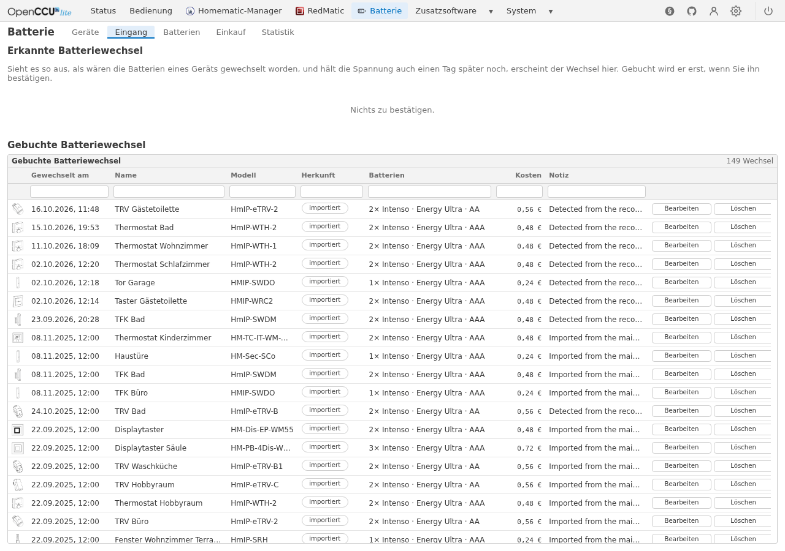</picture>

What the detector takes for a battery change waits here for your answer: yes (with the batteries
that went in), on another day, or no. On the system shown nothing is waiting. Below it every
recorded change of every device.

### Batteries (Batterien)

<picture><source media="(prefers-color-scheme: dark)" srcset="docs/screenshots/05-batterien-dunkel.png">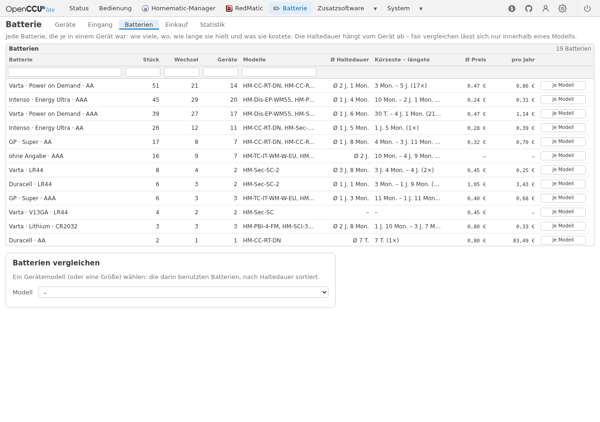</picture>

Every battery ever entered, by vendor, product line and size: how many went in, in how many
changes and devices, in which models, how long they lasted and what they cost per battery and
per year.

<picture><source media="(prefers-color-scheme: dark)" srcset="docs/screenshots/06-batterien-modelle-dunkel.png">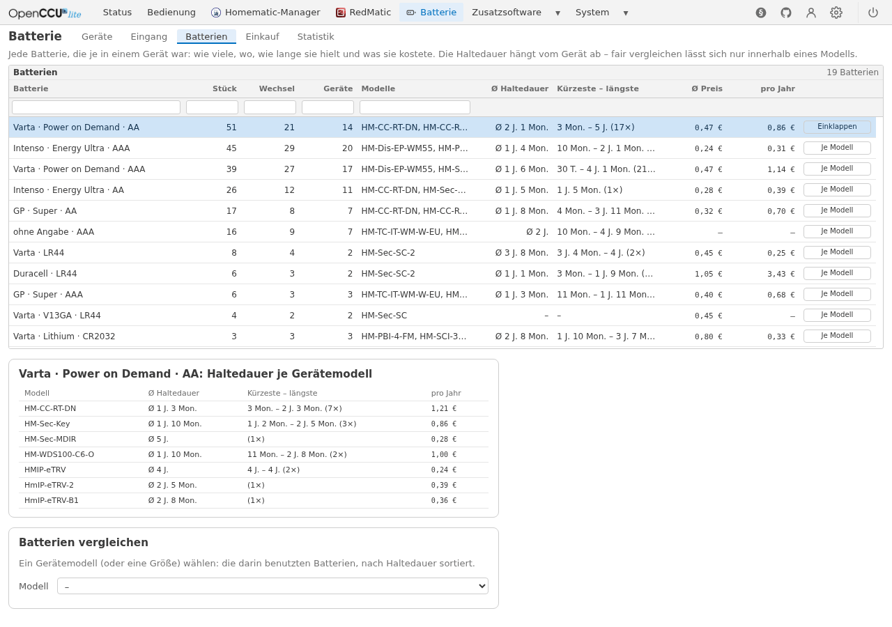</picture>

How long a battery lasts depends on the device: *Je Modell* (per model) splits it by device model.

<picture><source media="(prefers-color-scheme: dark)" srcset="docs/screenshots/07-batterien-vergleich-dunkel.png">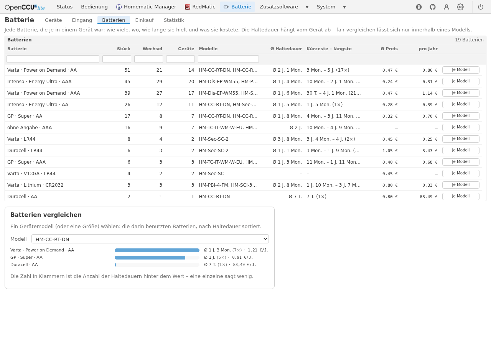</picture>

So batteries compare fairly only within one model or one size: here the batteries that were in
the HM-CC-RT-DN radiator thermostats, sorted by life, with their cost per year. The number in
brackets is how many lives the value rests on.

### Shopping (Einkauf)

<picture><source media="(prefers-color-scheme: dark)" srcset="docs/screenshots/08-einkauf-dunkel.png">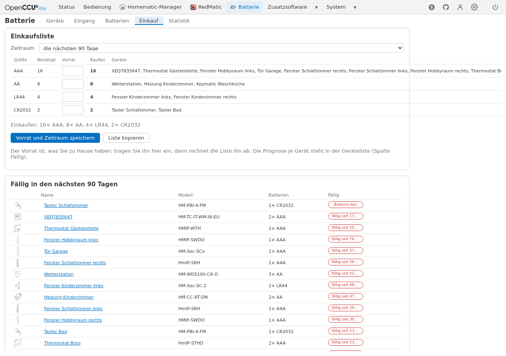</picture>

Which devices report low now or fall due in the chosen period, what they need per battery size,
set against the stock at home, and what to buy - copyable as a list. Below it the devices that
are due.

### Statistics (Statistik)

<picture><source media="(prefers-color-scheme: dark)" srcset="docs/screenshots/09-statistik-dunkel.png">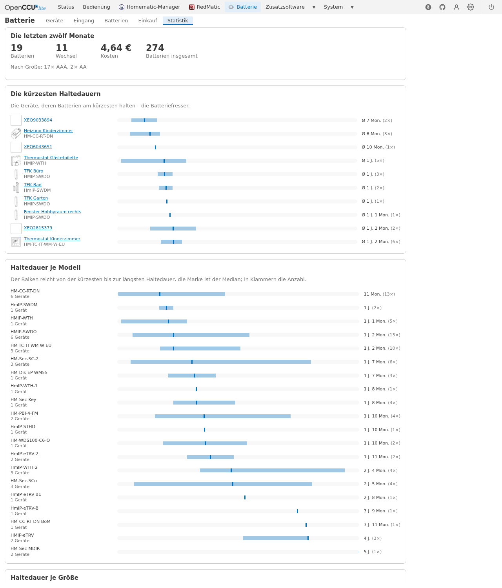</picture>

The last twelve months in numbers, the devices with the shortest battery lives (the battery
eaters) and the life per model and per size: the bar runs from the shortest to the longest, the
mark is the median. Further down, out of the picture, the exports.

### Settings

<picture><source media="(prefers-color-scheme: dark)" srcset="docs/screenshots/10-einstellungen-datenbank-dunkel.png">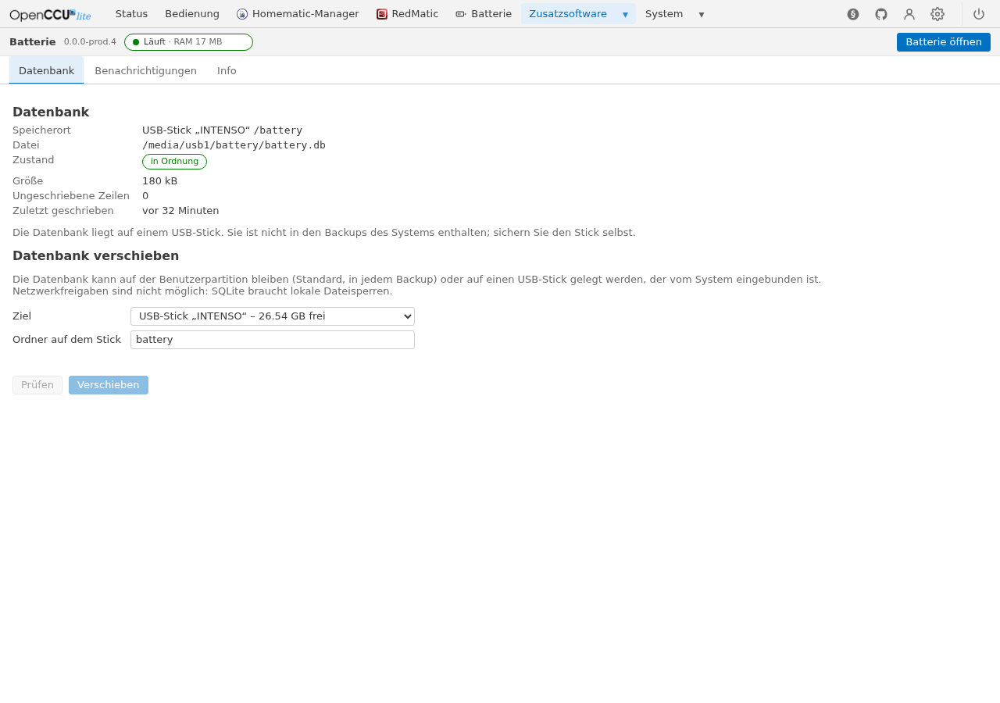</picture>

The settings page (on openccu-lite under *Zusatzsoftware → Batterie → Einstellungen*) shows where
the database lives and how it is doing, and moves it between the user partition (in every backup)
and a USB stick - here it is on the stick.

<picture><source media="(prefers-color-scheme: dark)" srcset="docs/screenshots/11-einstellungen-benachrichtigungen-dunkel.png">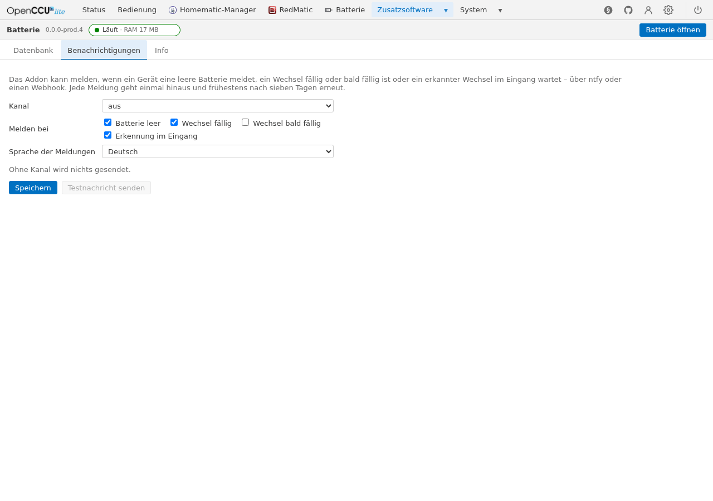</picture>

The notifications: the channel (ntfy or a webhook), what to report and the language of the
messages; a test message checks the channel. Without a channel nothing is sent.

<picture><source media="(prefers-color-scheme: dark)" srcset="docs/screenshots/12-einstellungen-info-dunkel.png">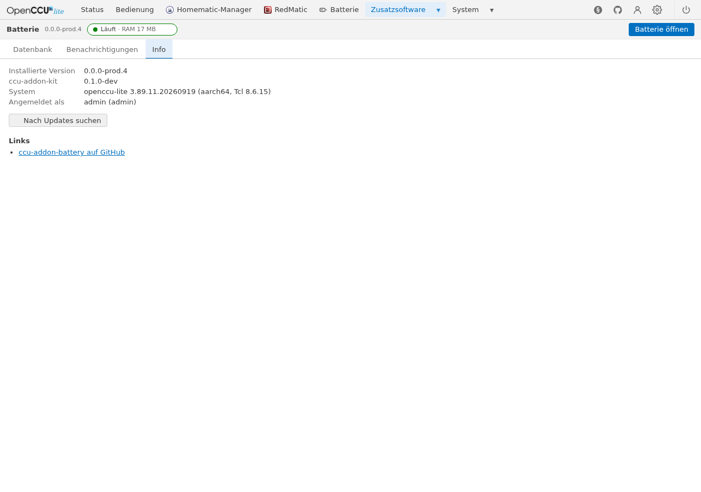</picture>

Info: the installed version, the system, and the check for a newer version, which goes to the
internet only when you click it.

## What it records

| Signal | Where | Devices |
| --- | --- | --- |
| `OPERATING_VOLTAGE`, `OPERATING_VOLTAGE_STATUS`, `LOW_BAT`, `BOOTED`, `UNREACH` | channel 0 | every Homematic IP device |
| `LOWBAT`, `UNREACH` | channel 0 | every BidCos radio device |
| `BATTERY_STATE` | the thermostat channel | HM-CC-RT-DN, HM-TC-IT-WM-W-EU |

The interfaces recorded are `HmIP-RF` and `BidCos-RF`. BidCos-Wired (mains-powered devices) and
VirtualDevices (the system's groups) are left out entirely: the addon lists no devices there and does
not register for their events. A device is tracked when its descriptions carry one of the battery
datapoints. At the start the
addon seeds the values from the system's state store and, for Homematic IP, from the radio
process's cache (no radio traffic); BidCos values are never read, only received. Samples are
downsampled: a row when the voltage moved by 0.01 V, when the low-battery flag changed, or once a
day. The low-battery and unreachable transitions and `BOOTED` are kept as evidence.

## Which batteries a device takes

[data/batteries.json](data/README.md) is a table of 459 Homematic models: the power source
(battery, rechargeable, mains, bus, …), the battery slots (count and type), the voltage datapoint,
the device's own low-battery threshold, and the sources every row stands on - for most battery
models eQ-3's own product pages and manuals. The data is CC0: take it for any project. The addon
embeds it, looks models up case-insensitively (and by their aliases), and lets you correct it
per model or per device (a remote in a desk stand, lithium or rechargeable cells). Corrections to
the table are welcome as pull requests; `python3 data/check.py` checks it (CI runs it), and
[tools/](tools/README.md) has the scripts it was built with.

## Detecting a battery change

A device restart (`BOOTED`), a voltage jump to the fresh level, or the low-battery flag clearing
makes a *candidate*. Re-seating the same half-used cells looks the same for a while - their voltage
recovers once the load is off - so a candidate only comes into the **inbox** when the voltage
still holds the fresh level a day later; otherwise it is logged as a boot. Nothing is booked on
its own: you confirm a detection, reject it, or say it was another day. Devices that report only
a low-battery flag are detected when the flag clears; for those, and for any other device,
*Changed…* records a change by hand. [docs/detection.md](docs/detection.md) has the rules.

## The batteries and what they cost

With every change you can say what went in, per slot: the vendor ("Varta"), the product line
("Power on Demand"), whether they are rechargeable, and the price of one battery. Vendor and
product line are suggested from what was recorded before, so one vendor is not written three
ways; the price is prefilled with the last one paid for that vendor and line. A *life* is the time
between two confirmed changes of a device; the statistics are built from the lives, the running
one counts in no average. The device pictures are the platform's own (the WebUI's catalogue,
which openccu-lite ships too).

## The API

Everything the page does goes through the addon's API at `/addons/battery/api/v1/`, behind the
system's login: devices with their battery profiles, pictures and lives, the changes (list,
record, confirm, edit, delete), bulk imports of past changes (JSON or CSV, with a dry run,
deduplicated and merged with what the detector found), voltage series, a detection run over
imported history, value suggestions, the last price, the statistics and exports.
[docs/api.md](docs/api.md) explains it with a curl recipe; [docs/openapi.json](docs/openapi.json)
specifies it.

## On openccu-lite

Install the package from the Addons page (or, once listed, from the catalogue). The addon runs
confined as its own user, reads the system's APIs with its own token (`rpc:read`, `meta:read`) and
serves its page at `/addons/battery/`, embedded in the system's shell with its theme and language;
its settings page is `/addons/battery-config/`. Updates come from the system's Addons page.

### Where the database lives

The database is one SQLite file, `battery.db`. By default it is in the addon's own directory on
the user partition, `/usr/local/addons/battery/var/`, which every backup of the system includes.
It can be moved to a USB stick the system has mounted (the settings page); the stick is **not**
part of the system's backups, and the page says so. Network shares are not offered: SQLite needs
local file locking, which NFS and SMB do not give.

The move is safe: the writers pause (new values wait in memory), the pending rows are written, a
consistent copy is made with `VACUUM INTO`, the copy is verified (`integrity_check`, the row count
of every table), the setting is switched, the addon reopens on the new file, and the old file is
kept or removed as you chose. If any step fails, nothing changes. When a stick with the database
is pulled, the addon keeps the new values in memory (up to 20,000 rows), says so on its page and in
the journal, and goes on where it was once the stick is back - it never starts a fresh database
somewhere else on its own.

The setting is `storage` in `/usr/local/addons/battery/etc/battery.json`
(`{"storage": {"location": "usb:<label>", "folder": "battery"}}`); the details are in
[docs/storage.md](docs/storage.md).

### Uninstall

Removes the program and keeps `/usr/local/addons/battery/etc` (the settings) and `var` (the
database) for a reinstall. Remove that directory by hand to be rid of the data.

## On a CCU3 or OpenCCU

The same package installs as a classic addon (*Einstellungen → Systemsteuerung → Zusatzsoftware*,
or `/bin/install_addon` on OpenCCU). There the daemon records from the interface processes
themselves - it registers for their events over XML-RPC on the loopback (port 8292), lists the
devices and reads the Homematic IP channel 0 from the process's cache every quarter of an hour -
and takes the names and rooms from ReGaHSS; the WebUI's *Einstellungen* button of the addon opens
the settings page (service, log, database, notifications, version), whose *Open Battery* button
opens the app with the WebUI's session. Nothing but the web server faces the network. The
settings and the database live in `/usr/local/addons/battery/etc` and `var`, in every backup;
`Deinstallieren` keeps them, as above. Tested on OpenCCU 3.89 (x86_64) and on a CCU3 with eQ-3's
firmware 3.89.11 (`armv7l`), there so far without paired battery devices - feedback is welcome.

## Development

```sh
go test -race ./...                      # the store, the recorder, the detector, the changes, the statistics, the API, the package files
python3 data/check.py                    # the battery table
(cd ui && npm ci && npm run check && npm test && npm run build)   # the app and the settings page
VERSION=1.0.0 scripts/build.sh           # dist/battery-<arch>-<version>.tar.gz for aarch64, x86_64, armv7l
```

The Go side uses [ccu-addon-kit](https://github.com/hobbyquaker/ccu-addon-kit)'s `addonkit`
(session, CSRF, token, manifest) and `litesource` (the event stream with resume, the state store,
the metadata API); the web app is Svelte 5 on [occulite-ui](https://github.com/hobbyquaker/occulite-ui)
with [uPlot](https://github.com/leeoniya/uPlot) for the voltage curve; the settings page is the
kit's frame with the addon's own tab, vendored into the package by `ccu-addon-kit vendor` from
[addon/kit.json](addon/kit.json). The daemon takes `-no-session-check` and `-token-file` for
development against a system other than the one it runs on:

```sh
go run ./cmd/battery -addon-dir /tmp/battery -www ui/dist -system http://<system> -token-file ./token -no-session-check
```

## Licence

MIT; the battery table (`data/batteries.json` and its schema) is CC0-1.0.
